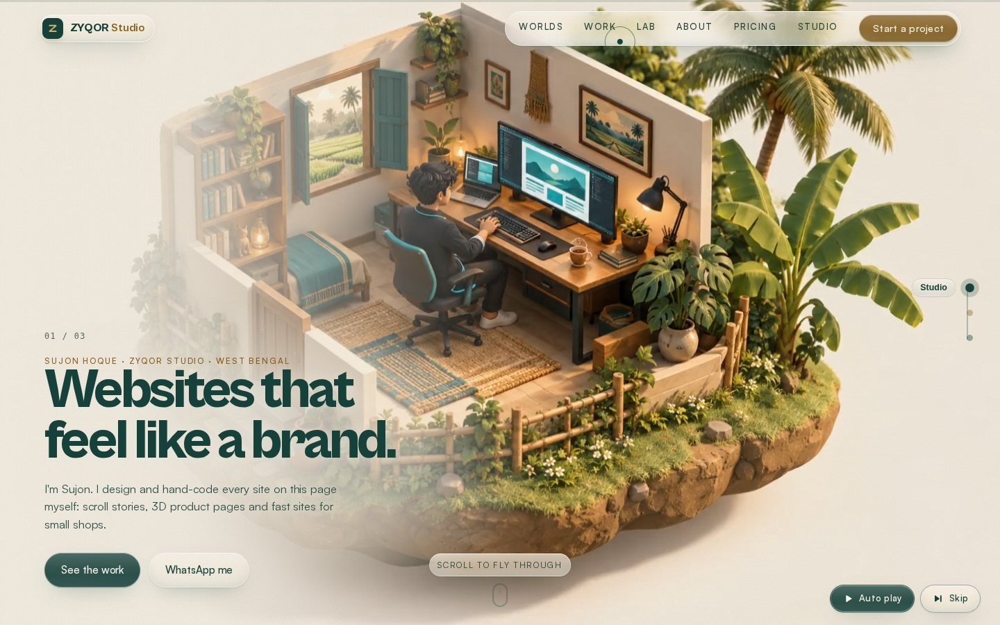
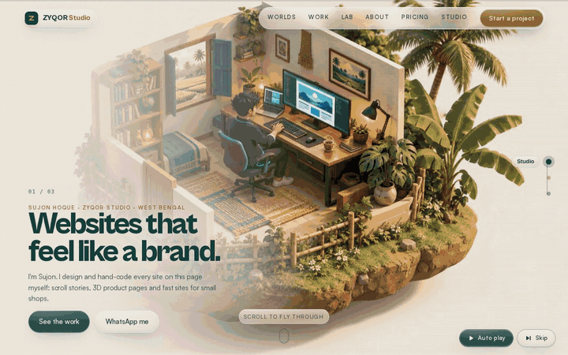
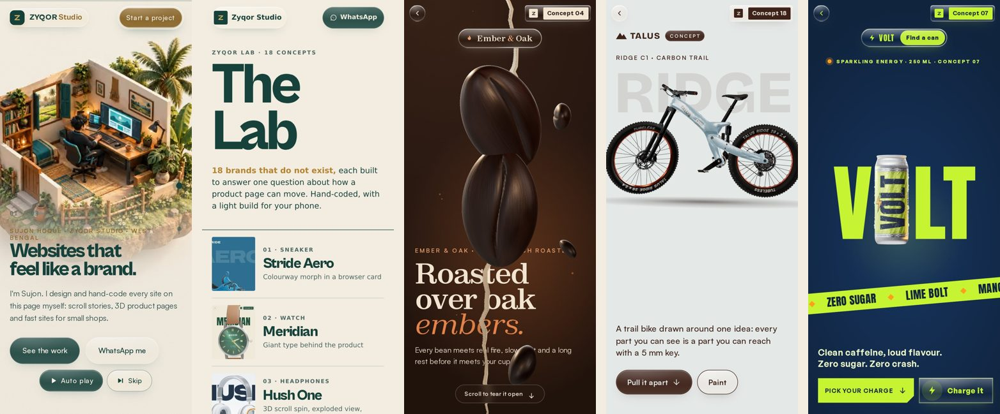
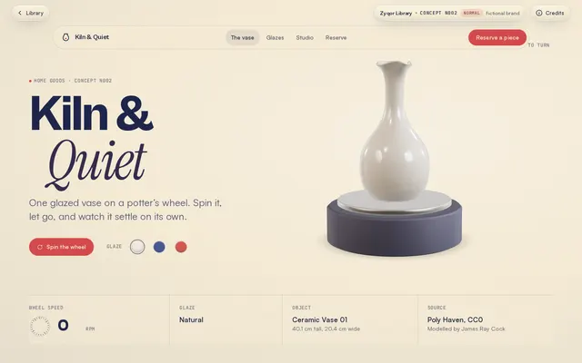
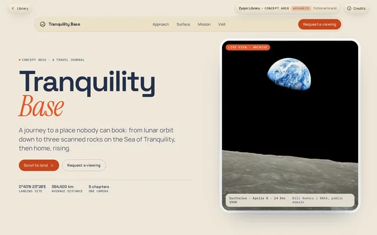
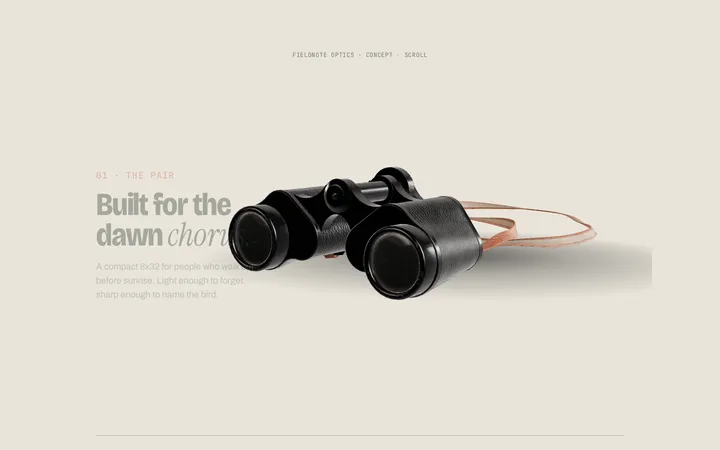
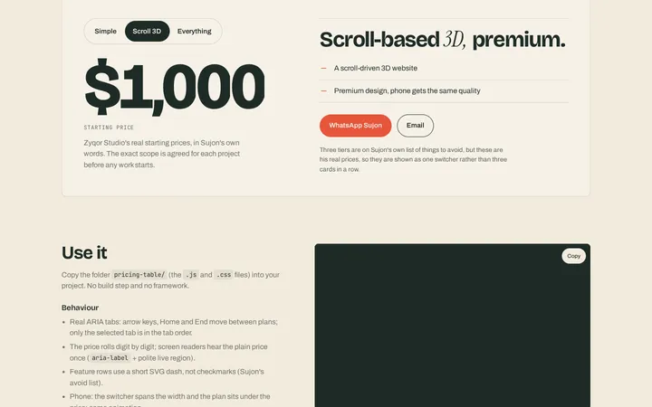
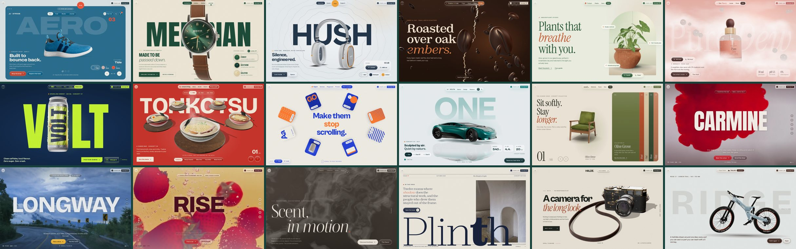

<p align="center">
  
</p>

<h1 align="center">Best Website Designer: Zyqor Studio portfolio</h1>

<p align="center">
  Hand-coded portfolio of <b>Sujon Hoque</b> (Zyqor Studio): scroll-driven 3D worlds, a lab of eighteen interactive concept sites, studio pages on colour, type, process and UI, a liquid-glass interface and a separate light build for phones.<br>
  HTML &middot; CSS &middot; JavaScript &middot; three.js &middot; GSAP &middot; Lenis &mdash; no framework, no build step.
</p>

<p align="center">
  <a href="https://zyqor-portfolio.vercel.app/"><b>Live site</b></a> &nbsp;&middot;&nbsp;
  <a href="https://zyqor-portfolio.sites.tab.bot/">Preview mirror</a> &nbsp;&middot;&nbsp;
  <a href="#zyqor-lab">Lab concepts</a> &nbsp;&middot;&nbsp;
  <a href="#zyqor-library-300-3d-concepts-in-progress">300-concept library</a> &nbsp;&middot;&nbsp;
  <a href="site/components/">Components</a> &nbsp;&middot;&nbsp;
  <a href="#skills-how-to-build-unique-premium-websites-the-core-of-this-repo"><b>Skills</b></a> &nbsp;&middot;&nbsp;
  <a href="#inspiration">Inspiration</a> &nbsp;&middot;&nbsp;
  <a href="#run-it-locally">Run locally</a> &nbsp;&middot;&nbsp;
  <a href="#deploy-on-vercel">Deploy</a> &nbsp;&middot;&nbsp;
  <a href="mailto:zyqorbusiness@gmail.com">Hire me</a>
</p>

<p align="center"></p>

<p align="center"></p>

---

## Skills: how to build unique, premium websites (the core of this repo)

This repo's main goal (Sujon, 30 Oct 2026): **teach an AI agent, through many detailed skills, exactly how to design and build unique, premium, advanced websites**: the idea, colour, fonts, layout, motion, 3D, tiers, phone parity and the rest. Desktop is the top bar (*"PC me no compromise, ek dam best"*); the phone gets the same quality. Every point from his design Drive and from [scroll-world](https://github.com/oso95/scroll-world) (MIT, by cyw) is folded into these skills, credited, with a point-by-point map in [`docs/beast/SKILLS_SOURCE_MAP.md`](docs/beast/SKILLS_SOURCE_MAP.md). The concepts, components and Lab sites further down are **examples** of the skills in use.

Each skill is a folder an agent can read (`SKILL.md` with frontmatter, rules with reasons, numbers, tested code, a premium / advanced / normal tier table, a pre-ship checklist, sources), plus scripts and a working example checked at 1440, 390 and 360 px with 0 console errors.

| Skill | What it teaches |
|---|---|
| [`unique-idea-and-concept`](skills/unique-idea-and-concept/) | Find the one big idea, its metaphor, story arc, chapters and camera grammar before design starts. |
| [`colour-systems`](skills/colour-systems/) | Premium 3-colour palettes (OKLCH, WCAG-checked): no black, no purple, no neon, no decorative gradients. |
| [`typography-premium`](skills/typography-premium/) | Font pairing, fluid type scale, tracking and leading, craft details, loading, font licences. |
| [`layout-grid-spacing`](skills/layout-grid-spacing/) | 14 named page structures, grid, 8-point spacing, ledgers, sticky narratives, phone re-composition. |
| [`premium-tiers-normal-advanced-premium`](skills/premium-tiers-normal-advanced-premium/) | What separates $300 / $1k / $10k sites: features, budgets, red flags, scorecard. |

Coming in the next batches today: motion and scroll storytelling, three.js 3D premium, micro-interactions and cursor, responsive phone/PC parity, performance (desktop max), imagery and licensing, copywriting, SEO and meta, accessibility and reduced motion, award-site teardown, client delivery workflow, and the master playbook.

The tool skills (qa-harness, liquid-glass-ui, model-optimisation-phone, scroll-video-hero, unique-concepts, web-security) are listed in [`skills/README.md`](skills/README.md).

## What's inside

| Section | What it does |
|---|---|
| **Scroll-world intro** | A camera flight from the studio through concept brands to a main street, scrubbed frame-by-frame by scroll (scrub engine adapted from the MIT-licensed scroll-world skill by cyw, extended for Zyqor Studio). |
| **Worlds** | Five pinned scroll scenes around one live three.js product: colourway morph in a browser card, giant type behind the product, exploded callouts, orbit carousel, organic mask reveal. |
| **Work** | Six real, live projects in a pinned horizontal gallery with hover video. |
| **Zyqor Lab** | Eighteen complete concept sites for fictional brands, each built around one signature interaction (below). |
| **Concept library** | The 18 built library concepts as cards with real screenshots, plus two phone screen recordings (N020 simple, P017 premium), linking to each concept's desktop and phone page. |
| **Components** | The 14 component demos as cards, linking to each live demo. |
| **Studio pages** | [Colour theory](site/color/), [Process](site/process/), [Services](site/services/), [Type specimen](site/studio/type/), [Case study](site/studio/case/) and a [UI micro-interaction gallery](site/studio/ui/), each with its own phone build. |
| **Liquid glass** | One shared glass material (`site/assets/glass/`) on every screen: nav pills, buttons, mode switches, cards and the Lab chrome. Refraction and a cursor-following highlight on desktop, a lighter blur on phones. |
| **About / Pricing / Contact** | Copy-to-clipboard email, WhatsApp and Gmail links, big footer wordmark. |

Two builds, one site: the **desktop build** (`/`) is the heavy one (WebGL, Lenis smooth scroll, GSAP ScrollTrigger pins). The **phone build** (`/m/`) is a separate, lighter page (native scroll, smaller models and clips, no hover-only UI). A tiny inline script at the top of each page sends phones to `/m/` and desktops back to `/`; add `?desktop=1` to stay on the phone build on a laptop.

## Zyqor Library: 300 3D concepts (in progress)

A growing library of **300 interactive 3D concept pages**, each a complete mini landing page for a fictional brand with a 3D object at its heart, in three tiers:

| Tier | What it shows | Count |
|---|---|---|
| **Normal** | One light three.js scene (a small real model or crafted geometry) plus one signature interaction | 100 |
| **Advanced** | Scroll-driven 3D scenes, shaders, physics, particles, frame sequences from our own renders | 100 |
| **Premium** | Detailed real CC0/CC-BY models, PBR materials, HDRI lighting, liquid glass, cinematic scroll | 100 |

Open it at [`site/library/`](site/library/) (live preview: `/library/`). The index filters by tier, category and technique; concepts that are not built yet show as palette cards marked *Coming*, and concepts in review show *In QA*. **Live now: 18** (N001 Loomhouse Tailors, N002 Kiln & Quiet, N003 Tidewell Salt, N004 Morrow Light, N005 Fieldnote Optics, N006 Quarry Type Foundry, N007 Brasswick Diya, N008 Northpine Cabins, N009 Glasskit Toggles, N010 Rootline Citrus, N014 Glint Eyewear, N020 Chordline Music School, N025 Bathtime Duck, N048 Ironbark Barbers, A013 Shelfline Ceramics, A018 Tranquility Base, A027 Cut & Grain Knives, and the first premium concept, P017 Tapehead Hi-Fi). Concepts go live in batches of 25, each only after it passes QA at 1440 / 390 / 360 with 0 console errors, and each has a desktop page and a phone page that load the **same** models, textures and lighting. Every concept is also checked against a 118-point requirements list (a second QA pass after the build, written up in `docs/beast/`), and every asset ships with a credit file next to it (`<asset>.credit.json`: exact licence and version, source page, required attribution, changes), gated by `node tools/credits-check.mjs`.

<p>
  
  
</p>

Since Oct 30 every concept also gets a **premium layer** from the kit (a colour-blocked type band built from the page's own headings, headings that rise out of a mask, a scroll progress line and the brand name as a giant rising wordmark in the footer). Built with a shared kit (`site/library/_kit/`: one-call three.js stage with HDRI, ACES, contact shadow, lazy loading, pause off-screen and poster fallback; concept chrome; interaction modules) and a batch QA harness (`tools/qa-library.mjs`). How to add a concept: [`site/library/README.md`](site/library/README.md). The rules every concept follows: [`docs/beast/DESIGN_RULES.md`](docs/beast/DESIGN_RULES.md).

## Components: 14 detailed UI pieces

[`site/components/`](site/components/) is a free library of 14 reusable components, each with a live demo page that works the same on desktop and phone, plain HTML/CSS/JS (no framework, no build step), keyboard and touch support, reduced-motion handling, SVG icons and its own README with credits. **Live gallery: https://zyqor-concepts.sites.tab.bot/components/**

<p> </p>

| Component | What it does |
|---|---|
| [Scroll-scrubbed 3D stage](site/components/scroll-3d-stage/) | Real CC0 scan + HDRI; camera and model move through chapter keyframes with scroll; lazy, poster fallback. |
| [Magnetic button](site/components/magnetic-button/) | Leans toward the pointer, fills from the entry point, rolls its label; tap ripple on phones. |
| [Split text reveal](site/components/split-text/) | Line-mask rise, letter flip and scroll-scrub reading highlight; re-measures lines, screen-reader safe. |
| [Liquid glass card](site/components/liquid-glass-card/) | Edge refraction via SVG displacement (Chromium), blur fallback, specular highlight, tilt, draggable. |
| [Sticky storytelling](site/components/sticky-story/) | Pinned media with chapter wipes, progress line, numbered rail; same on phone. |
| [Marquee](site/components/marquee/) | Seamless loop, speeds up with scroll velocity, flips with scroll direction, drag with inertia. |
| [Cursor follower](site/components/cursor-follower/) | Dot + lagging ring, label over work, sticky ring on links, hides over inputs, off on touch. |
| [Image trail and hover reveal](site/components/image-trail/) | Pointer image trail and a hover-reveal project list that turns into a tap accordion on phones. |
| [Preloader](site/components/preloader/) | Counts real bytes of the model/HDRI/images, never flashes on cached loads, panel-wipe exit. |
| [Page transition](site/components/page-transition/) | Circle reveal from the click point between pages (native View Transitions + fallback) and for a theme switch. |
| [Pricing switcher](site/components/pricing-table/) | Zyqor's real $300 / $1k / $10k tiers: squish pill, odometer price, ARIA tabs. |
| [Quote carousel](site/components/quote-carousel/) | Native scroll-snap swipe, mouse drag with inertia, accessible autoplay with Pause; real quotes, no fake reviews. |
| [Mega menu](site/components/mega-menu/) | Desktop mega panels with hover intent + keyboard; phone full-screen accordion sheet with focus trap. |
| [Footer with wordmark](site/components/footer-wordmark/) | Giant per-letter rising wordmark, Gmail-on-desktop / mailto-on-phone, copy email, local time, legal links. |

They were built after a study of current award-winning sites: **[How top designers build unique websites](docs/how-top-designers-build-unique-sites.md)** walks through idea, story, layout, motion, 3D, sound and micro-interactions with named, linked examples (Awwwards Sites of the Year and Sites of the Day, CSS Design Awards) and a section on the techniques of [@ayzz.thedesigner](https://www.instagram.com/ayzz.thedesigner).

## Prices

Zyqor Studio's starting prices (exact scope agreed per project):

| Plan | From | What it is |
|---|---|---|
| Simple | **$300** | A simple website that still feels premium |
| Scroll 3D | **$1,000** | A scroll-based 3D website, premium |
| Everything | **$10,000** | Everything: content, top quality, fast delivery |

Contact: [zyqorbusiness@gmail.com](mailto:zyqorbusiness@gmail.com) or [WhatsApp](https://wa.me/919547908593).

## Skills you can download

[`skills/`](skills/) holds free, tested, MIT-licensed skills: a written method (`SKILL.md`), a working example and starter code each. Ready now: **qa-harness**, **liquid-glass-ui**, **model-optimisation-phone**, **unique-concepts** (now with the award-site study), **web-security** (build security in from the first file, plus a scanner for a folder or a live URL: `node skills/web-security/check.mjs site`), **scroll-video-hero** (the scroll-scrubbed video at the top of this site, as a downloadable skill with a working example). More are added with every batch; the full list is in [`skills/README.md`](skills/README.md).

## Zyqor Lab

Every Lab brand is **fictional** and every page says so. Nothing is for sale, no real company is shown, and there are no invented reviews or clients.

**Real models (Oct 28):** all seven demos that used code-built objects (Ember, Umami, Volt, Dew, Meridian, Signal, Hush) now use real CC0/CC-BY models and scans, with logos removed and credits in [CREDITS.md](CREDITS.md). Every Lab demo shows a poster still when WebGL is unavailable.

| # | Concept | Product | Signature interaction | Palette | Open |
|---|---|---|---|---|---|
| 01 | **Stride Aero** | Sneaker | Colourway morph in a browser card | `#E6E4DF` `#12313A` `#E8553B` | [desktop](site/lab/stride/) / [phone](site/lab/stride/m.html) |
| 02 | **Meridian** | Watch | Giant type behind the product | `#EFE8D8` `#1F4D3A` `#C9A24A` | [desktop](site/lab/meridian/) / [phone](site/lab/meridian/m.html) |
| 03 | **Hush One** | Headphones | 3D scroll spin, exploded view, callouts | `#E7ECEF` `#24364A` `#F0A23B` | [desktop](site/lab/hush/) / [phone](site/lab/hush/m.html) |
| 04 | **Ember & Oak** | Coffee roasters | Paper-tear reveal, travelling cup | `#2B1A12` `#F2E6D3` `#C26A3D` | [desktop](site/lab/ember/) / [phone](site/lab/ember/m.html) |
| 05 | **Verdant** | Plant studio | Organic mask reveal, arched window | `#EEF0E4` `#2F5D3A` `#C8643B` | [desktop](site/lab/verdant/) / [phone](site/lab/verdant/m.html) |
| 06 | **Dew Theory** | Skincare | Cloud world, podium, ingredient orbit | `#F6E3DF` `#B85C5C` `#4A2E2A` | [desktop](site/lab/dew/) / [phone](site/lab/dew/m.html) |
| 07 | **VOLT** | Sparkling energy | Can into wordmark, flavour flood | `#10243E` `#C6F432` `#FF9F1C` | [desktop](site/lab/volt/) / [phone](site/lab/volt/m.html) |
| 08 | **Umami Ring** | Ramen bar | Orbit carousel menu | `#F4E9D8` `#C8342B` `#2E4A3B` | [desktop](site/lab/umami/) / [phone](site/lab/umami/m.html) |
| 09 | **Signal Studio** | Creative agency | Radial card fan, bento, physics | `#F1EEE6` `#2340D8` `#FF7A2F` | [desktop](site/lab/signal/) / [phone](site/lab/signal/m.html) |
| 10 | **Volta One** | Electric car | Giant name swap, night mode, spec track | `#E9EEF0` `#0F7C7A` `#F26B3A` | [desktop](site/lab/volta/) / [phone](site/lab/volta/m.html) |
| 11 | **Nook** | Furniture | Accordion colour bars, odometer counter | `#EDE5D8` `#5B6B3A` `#B5512E` | [desktop](site/lab/nook/) / [phone](site/lab/nook/m.html) |
| 12 | **Carmine No.7** | Fountain pen ink | Video flow: scroll-scrubbed real footage | `#F4EFE9` `#2B0A0E` `#D81E2C` | [desktop](site/lab/carmine/) / [phone](site/lab/carmine/m.html) |
| 13 | **Longway** | Overland road trips | Video flow: scroll-scrubbed real footage | `#E9EDF0` `#16212D` `#F2B42F` | [desktop](site/lab/longway/) / [phone](site/lab/longway/m.html) |
| 14 | **Rise No.3** | Sparkling strawberry water | Video flow: scroll-scrubbed real footage | `#F8EBCB` `#4A0F1E` `#E3343B` | [desktop](site/lab/rise/) / [phone](site/lab/rise/m.html) |
| 15 | **Fumée** | Perfume house | WebGL smoke field, pinned liquid scent swap, kinetic type | `#EEE7DC` `#36302B` `#A44A3F` | [desktop](site/lab/fumee/) / [phone](site/lab/fumee/m.html) |
| 16 | **Plinth** | Architecture quarterly | Editorial grid, variable-font type, clip reveals, horizontal gallery | `#EDE8DE` `#19233B` `#DA4A2A` | [desktop](site/lab/plinth/) / [phone](site/lab/plinth/m.html) |
| 17 | **HALDE R1** | Rangefinder camera | Real scanned camera, finish switch, light modes, exploded lens | `#E9E2D6` `#20241F` `#A85537` | [desktop](site/lab/halde/) / [phone](site/lab/halde/m.html) |
| 18 | **TALUS Ridge C1** | Carbon trail bike | Real scanned bike, scroll explode, colourway + dusk light modes | `#ECE6DC` `#3D2219` `#8FB3C7` | [desktop](site/lab/cadence/) / [phone](site/lab/cadence/m.html) |

<p align="center"></p>

Each demo has its own three-colour palette, its own type pairing, a desktop page (`index.html`) and a phone page (`m.html`).

## Studio pages

| Page | What it shows |
|---|---|
| [`/color/`](site/color/) | How Zyqor picks a three-colour palette: live palette demos, contrast checks, the 60-30-10 split. |
| [`/process/`](site/process/) | The five steps from first message to launch, with timelines. |
| [`/services/`](site/services/) | What a project includes, from a one-page site to a full 3D build. |
| [`/studio/type/`](site/studio/type/) | A type specimen and pairing system with a live tester. |
| [`/studio/case/`](site/studio/case/) | One fictional project (Kilnfold, ceramics) told end to end, brief to launch. |
| [`/studio/ui/`](site/studio/ui/) | A gallery of micro-interactions: magnetic buttons, toggles, sliders, cards. |

## Liquid glass

`site/assets/glass/liquid-glass.css` and `liquid-glass.js` are one reusable material. A page opts in with a link tag and a small JSON map of selectors (`<script type="application/json" id="lg-map">`), so markup stays clean. On desktop the glass refracts the page behind it (an SVG displacement filter) and catches a highlight that follows the cursor; on phones it switches to a lighter blur with no filter so scrolling stays at 60 fps. It tints itself from each page's own palette, falls back to solid surfaces when `backdrop-filter` is missing or the visitor asks for reduced transparency, and goes still for reduced motion. Details: [site/assets/glass/README.md](site/assets/glass/README.md).

## Video Flow: drop a video, get a scroll site

Not every site needs hand-coded visuals. `tools/video-flow/` turns any video (real footage, a product shoot, or a 3D/AI product render) into a finished scroll-scrubbed page with a light phone build.

1. Put your video anywhere and copy an example config from `tools/video-flow/examples/`.
2. Edit the copy beats, palette and fonts in the JSON.
3. Run `npm run video-flow -- path/to/config.json` (Node 18+ and ffmpeg). The page appears in `site/lab/<slug>/`.

Concepts 12-14 in the Lab were built exactly this way from free Mixkit footage. Full guide and config reference: [tools/video-flow/README.md](tools/video-flow/README.md).

## Tech stack

- **three.js r170** for WebGL: procedural products (lathe / extrude geometry, physical materials, custom shaders) plus a few CC0 / CC-BY glTF models, compressed with meshopt and WebP textures.
- **GSAP 3 + ScrollTrigger** for pins, scrubs and timelines; **Lenis** for smooth scroll on desktop.
- **Matter.js** for the physics playground in the Signal demo.
- Plain HTML / CSS / ES modules. Fonts self-hosted as WOFF2 (OFL). No CDN at runtime, no tracking, no build step.

Built-in rules the code follows:

- `prefers-reduced-motion` is respected everywhere: no autoplay, no scroll pinning, instant state changes.
- Below-the-fold content reveals lazily; heavy 3D starts only when it's near the viewport.
- Icons are inline SVG. Zero console errors at 1440&times;900 and 390&times;844.
- Real buttons with `aria-label`s, keyboard arrows on carousels, visible focus rings.

## Folder structure

```
best-website-designer/
  site/                  <- the whole website (this is what gets deployed)
    index.html           desktop home
    m/                   phone home (index.html, m.css, fx-m.js, config-mobile.js)
    site.css fx.css worlds.css
    app.js fx.js scrub-engine.js config-desktop.js
    js/worlds.js         the five Worlds scenes
    lab/
      _kit/              shared Lab code: kit.js (renderer, loaders, reveals), chrome.js, lab.css, registry.js
      _template/         starting point for a new concept
      index.html m.html  the Lab index (desktop / phone)
      stride/ meridian/ hush/ ember/ verdant/ dew/ volt/ umami/ signal/ volta/ nook/
      carmine/ longway/ rise/ fumee/ plinth/ halde/ cadence/
                         each: index.html, style.css, app.js (desktop) + m.html, m.css (phone) + poster.webp
    color/ process/ services/   studio pages (index.html desktop + m.html phone)
    studio/type/ studio/case/ studio/ui/
    404.html privacy.html
    assets/              fonts, 3D models, HDRI lighting, images, clips
    assets/glass/        the liquid-glass material (CSS + JS + README)
    vendor/              three.js, GSAP, ScrollTrigger, Lenis, Matter.js (self-hosted)
  tools/video-flow/      video -> scroll-site generator (see above)
  tools/check-links.mjs  checks every internal and external link before a deploy
  docs/                  screenshots and GIF for this README, design notes, PROJECTS.md
  vercel.json            tells Vercel to serve the site/ folder
  CREDITS.md             every font, model, photo and library with its licence
  LICENSE.md
```

## Run it locally

Eight large 3D model files are stored as numbered parts (`*.glb.part1`, `*.glb.part2`). One command puts them back together (it checks every file's checksum and takes about a second):

```bash
node tools/join-parts.mjs
```

Then any static server works. From the repo folder:

```bash
npx serve site
# or
cd site && python3 -m http.server 8080
```

`npm run dev` does both steps for you.

Then open `http://localhost:3000` (serve) or `http://localhost:8080`. In VS Code you can also right-click `site/index.html` and choose **Open with Live Server**.

Note: open it through a server, not by double-clicking the file; ES modules and 3D models don't load from `file://`.

To see the phone build on a laptop: `http://localhost:3000/m/?desktop=1`, or use Chrome DevTools device mode.

## Deploy on Vercel

Live on Vercel: **https://zyqor-portfolio.vercel.app/** (project `zyqor-portfolio`, linked to this repo's `main`; every push to `main` redeploys it).

It's a static site. The only build step is rebuilding the large model files, which Vercel runs for you.

1. Run `npm run check:links` (or `node tools/check-links.mjs --all`) and fix anything it flags.
2. Push this repo to GitHub.
3. On vercel.com: **Add New &rarr; Project &rarr; Import** the repo.
4. Framework preset: **Other**. Leave the build command empty. `vercel.json` already sets the output folder to `site`.
5. **Deploy.**

Or from the terminal: `npm i -g vercel` then `vercel --prod` in the repo folder.

Netlify or Cloudflare Pages work the same way: build command `node tools/join-parts.mjs`, publish folder `site`. For GitHub Pages, run `node tools/join-parts.mjs` first and publish the `site` folder.

## Add a new Lab concept

1. Copy `site/lab/_template/` to `site/lab/<your-slug>/`.
2. Build the desktop page in `index.html` / `style.css` / `app.js` and the phone page in `m.html` / `m.css`.
3. Add an entry to `site/lab/_kit/registry.js` and a card in the Lab grid of `site/index.html` and `site/m/index.html`.
4. Save `poster.webp` (1200&times;750) and `poster-m.webp` (720&times;450) for the grid.

## Performance

The whole `site/` folder is 103.5 MB, but a visitor only downloads the page they open. 3D models and videos start loading when their section comes near the screen, images use `loading="lazy"`, and the phone build loads compressed copies of the same models, so it looks the same at a fraction of the weight.

| Concept | Page code + posters | 3D models / media (`assets/lab/<slug>/`) |
|---|---|---|
| stride | 135 KB | 4.0 MB |
| meridian | 167 KB | built in code (procedural) |
| hush | 149 KB | 3.2 MB |
| ember | 177 KB | built in code (procedural) |
| verdant | 189 KB | 5.4 MB |
| dew | 133 KB | 243 KB |
| volt | 152 KB | 1022 KB |
| umami | 210 KB | 224 KB |
| signal | 196 KB | 257 KB |
| volta | 137 KB | 3.7 MB |
| nook | 131 KB | 9.3 MB |
| carmine | 83 KB | 2.9 MB |
| longway | 112 KB | 5.7 MB |
| rise | 111 KB | 6.3 MB |
| fumee | 122 KB | 755 KB |
| plinth | 106 KB | 1.7 MB |
| halde | 98 KB | 4.8 MB |
| cadence | 158 KB | 3.6 MB |

Shared libraries in `site/vendor/` (three.js, GSAP, Lenis, Matter.js) are self-hosted and cached for a year by `vercel.json`.

## His other work

Sujon's live apps, game and lesson site, with links, source repos and APK sizes: [docs/PROJECTS.md](docs/PROJECTS.md) &middot; all code on [github.com/zyqorbusiness-lab](https://github.com/zyqorbusiness-lab).

## Inspiration

Ideas and techniques in this repo were learned from these designers and sites. Nothing of theirs (code, images, fonts, text) is copied; every technique was rebuilt from scratch, and each component's README names exactly what it studied.

- **[@ayzz.thedesigner](https://www.instagram.com/ayzz.thedesigner)**, Abdul Mutakabar Ayaz (UI/UX designer, zz.studio.design): the colourway morph, giant type behind the product, the travelling hero object, reveal wipes, orbit carousels, callouts, kinetic type and the rising footer wordmark used across the Lab and the components. His work is the biggest single influence on this portfolio.
- **[scroll-world](https://github.com/oso95/scroll-world)** by cyw (MIT): the scroll-scrubbed camera-flight engine behind the intro, adapted in `site/scrub-engine.js` with the licence kept.
- **Awwwards Sites of the Year**: [Messenger](https://messenger.abeto.co) and [Igloo Inc](https://www.igloo.inc/) by abeto, [landonorris.com](https://landonorris.com/) by OFF+BRAND, [Lusion v3](https://lusion.co/), [Opal Tadpole](https://www.opalcamera.com/opal-tadpole), [Don't Board Me](https://dontboardme.com) by The First The Last, [Mana Yerba Mate](https://en.manayerbamate.com/), [Pangram Pangram](https://pangrampangram.com/) by Locomotive, Star Atlas by Hello Monday.
- **Awwwards Sites of the Day, Oct 2026**: [A24 by Ravi Klaassens](https://a24.raviklaassens.com/), [Emotion Agency](https://emotion-agency.com/), [ESR Bespoke](https://www.esrbespoke.au/) by NIGHTJAR, [FORMAT](https://format.obys.agency/) by Obys, [Belgrade Arbor](https://belgradearbor.rs/en) by Square43, [Overworld Audio](https://overworldaudio.com/), [Forge Automotive](https://forgeautomotive.co.uk/), [G. Colombel](https://guillaumecolombel.fr/).
- **CSS Design Awards** Websites of the Day, Oct 2026 (Eladio Dieste by ++hellohello and others).
- **UI libraries** studied for component ideas: Unlumen UI, Magic UI, SmoothUI and RetroUI.
- **Sujon Hoque's own design system** (Master Award Web Design System and Website-Building Guide v6), the rules every page here follows.

## Credits and licence

Fonts, 3D models, photos and libraries are listed with their licences in [CREDITS.md](CREDITS.md). See [LICENSE.md](LICENSE.md) for what you may reuse.

- The hand-written code is MIT-licensed. Every brand in the Lab is fictional and every page says so.
- 3D models keep their own licences (CC0 or CC BY 4.0 from Khronos, Poly Haven and others; each is credited on its demo page and in CREDITS.md).
- One exception to note: the bike in **TALUS Ridge C1** (`site/assets/lab/cadence/`) is "Carbon Frame Bike" by Robert Schweier and prefrontal cortex (realtime version by Felix Herbst), licensed **CC BY-SA 4.0**. Our modified version of that model file is shared under the same CC BY-SA 4.0 licence.
- Photos are from Unsplash, Pexels and Mixkit under their own free licences; no AI-generated images are used in the Lab.

---

<p align="center">
  <b>Zyqor Studio</b> &middot; Sujon Hoque &middot; West Bengal, India<br>
  <a href="mailto:zyqorbusiness@gmail.com">zyqorbusiness@gmail.com</a> &middot;
  <a href="https://wa.me/919547908593">WhatsApp</a> &middot;
  <a href="https://www.instagram.com/zyqor_og/">Instagram @zyqor_og</a>
</p>
