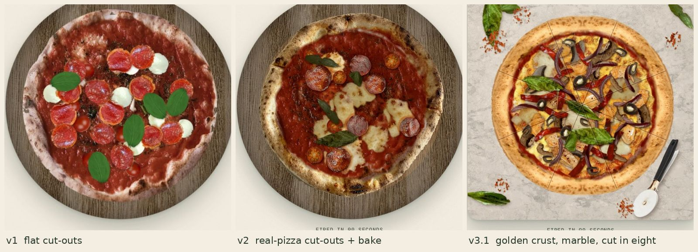

# Case study: P041 Hotcoal Kitchen, a pizza builder made three times

**What it is:** a concept site for a fictional wood-fired pizzeria where the page *is* the order. You drag real
ingredients onto a real base, press "Fire it", watch it bake, and order. Desktop: tray, board and ticket in three
columns, drag with a snap ring. Phone (`m.html`): the same pieces, tap to add, sticky total bar.

**Live:** https://zyqor-portfolio.vercel.app/library/p/P041/ · code: [`site/library/p/P041/`](../../site/library/p/P041/)
**Built:** 30 Oct 2026, in one day, in three versions. **Reference:** a reel by @online.by.annie (Instagram
DfGDN_fIZsC) showing a pizza-builder site; used for the idea only, nothing copied.

*Left to right: v1 (06:08 UTC), v2 (08:12 UTC), v3.1 (09:05 UTC). Screenshots of our own page; the photos inside are
credited at the end of this file.*

---

## Timeline

| Time (IST) | What happened | Commit |
|---|---|---|
| 10:42 AM | Sujon sends the reel and asks for the skill plus a no-compromise concept like it | - |
| 11:38 AM | **v1** live with the configurator skill | `d5dc6e0` |
| 11:48 AM | Sujon: *"accha nahi hai, real pizza jaisa nahi bana"* (not good, it doesn't look like a real pizza) | - |
| 1:41 PM | **v2** realism rework live | `3486d98` |
| right after | v2 follow-up: raw mozzarella with volume | `30e9ef3` |
| 1:51 PM | Sujon sends a veggie pizza photo from a food blog: *"Pizza aisa dikhta hai"* (this is how pizza looks). Copyrighted: style reference only | - |
| 2:15 PM | **v3** golden crust, veggies, marble, after-oven styling | `8cbdb89` |
| 2:26 PM | v3 follow-up: melted cheese sheet, bigger veggie pieces | `d3ef96e` |
| 2:31 PM | Sujon: *"kuch problems fix karo, pehle wala accha hai to wohi use karo"* (fix the problems; if the earlier one was better, use it). Two problems found: the pulled-out slice read as an odd grey wedge, and the olives were too many and looked identical | - |
| 2:35 PM | **v3.1** cut into eight instead of a pulled wedge; fewer, spaced olives | `6caaecf` |

At the time of writing, Sujon's verdict on v3.1 is pending.

## v1: real photos that still looked fake

**What we built:** real CC0 photos of loose ingredients, cut out and laid on a marinara base. Each piece was an ``
placed at a random percentage width. "Fire it" applied CSS `brightness / saturate / blur` filters.

**Why it failed:** the pieces read as **stickers**. No shadows, so nothing sat *on* the pizza. Every piece at a random
size, so a pepperoni could be as big as a tomato. Cheese was white balls on raw sauce. The bake was a photo filter,
and everyone has seen a photo filter.

**Lesson:** real photos are necessary, not enough. A photo of a mozzarella ball on a plate carries the plate's light,
camera and scale; a mozzarella patch cut from a photo of a finished pizza carries the pizza's.

## v2: one photo, one light, one scale

**What changed** (full method in [`interactive-product-configurator` §7b](../../skills/interactive-product-configurator/SKILL.md)):

- A `<canvas>` renderer instead of `` tags, redrawn only when something changes.
- Base: a real Neapolitan crust (Bex Walton, CC BY 2.0) around a real marinara (Ruthven, CC0). The raw state is the
  **same** crust re-toned toward pale dough in Lab, so baking reads as baking, not as a morph between two pizzas.
- Pieces cut from photos of **finished** pizzas, all at one pixel scale (base 2048 px), random scale only ±15 %.
- Two shadows per piece, multiplied, from one light direction: a soft one and a tight contact one.
- A raw and a baked photo for each piece, paired by index and cross-faded during the bake: cheese melts and browns,
  pepperoni cups and shines, tomatoes blister, basil wilts.
- Melt and oil pools under pieces, one warm grade over the whole pie, steam during the bake.
- 24 old v1 sprites deleted.

**The layout-shift bug found on the way:** on a cold load the page jumped badly, **CLS 2.0**. The shared stylesheets
(`chrome.css`, `liquid-glass.css`, `premium.css`) were loading late, so the layout changed after first paint. Making
them render-blocking in the P041 heads took cold-load CLS to **0.0002** locally and **0.000-0.005** on the live site.

**QA:** live on Vercel and sites.tab.bot at 1440 / 390 / 360: 0 console errors, 0 failed requests; drag, click, tap,
fire, remove and "again" all worked.

**Lesson:** realism is a *system* (scale, light, shadow, state), not a better photo. And measure cold loads: the CLS
2.0 never showed up on a warm reload.

## v3: matching the client's reference

Sujon's reference was a bright, food-magazine veggie pizza. We used it for **style only** (it is copyrighted) and
rebuilt every element from licensed photos.

- **Surface first:** a light warm marble slab (ambientCG Marble012, CC0, neutralised then tinted warm). It changed the
  mood more than any topping.
- **Golden crust, not charred:** the crust ring unwrapped to polar coordinates, the cleanest 90° arc mirrored four
  times round the rim, wrapped back, then browned in Lab. Inpainting the char spots had smeared grey.
- **Five veggie toppings from photos of those toppings on real pizzas:** olives (USDA, public domain), mushrooms (CC0
  and CC BY 2.0), artichoke (Daderot, CC0), roasted pepper (Ryan Snyder, CC BY 2.0), red onion (Sebastian Wallroth,
  public domain).
- **Density:** the reference covers about 60 % of the sauce; handfuls of 6-13 pieces got there.
- **After the oven, like a food stylist:** fresh basil on top, chili-flake pinches, a slicer, and a melted cheese sheet
  when mozzarella is on (Baron Maddock, CC BY 4.0).
- **A slice pulled out** to show the inside. This is the part that failed (below).

## What Sujon flagged on v3, and v3.1

| Problem | Why it happened | Fix in v3.1 |
|---|---|---|
| The pulled-out slice looked like an odd grey wedge | a 2D wedge moved out of a photo leaves a gap that has no real cheese pull, no side of the crust, no shadow of its own; it reads as a graphic | cut the pie into eight instead: each cut is a multiplied brown groove plus a light lip. Cut lines read as real |
| Too many olives, and they looked identical | 13 olives from 3 sprites: the eye spots repeats fast | 7 olives with a wider minimum gap |

## Lessons for every configurator (and every site)

1. **Define "real" before building.** v1 would have been skipped with a spec and a storyboard: one still of the baked
   pizza at 390 px would have shown the sticker look before any code. This is why
   [`build-spec-and-storyboard`](../../skills/build-spec-and-storyboard/) now comes first.
2. **Ask for the client's reference on day one.** The v3 direction (bright, golden, veggie, marble) existed in Sujon's
   head all along; one photo made it clear in a minute.
3. **One light, one scale, two shadows, two states.** The four rules that turned cut-outs into a pizza.
4. **Don't fake 3D in 2D.** A pulled wedge needs a real side and a cheese pull; if you can't photograph or model them,
   pick a move you can do honestly (cut lines).
5. **Repeats kill realism.** With a small sprite set, use fewer pieces with more space, plus rotation and mirroring.
6. **Measure cold loads.** CLS 2.0 → 0.0002 came from stylesheet load order, not from the canvas.
7. **Keep a way back.** Sujon's rule "if the earlier one was better, use it" only works if every version is a clean
   commit you can return to.
8. **Credit while you build.** v2 needed CC BY 2.0 added to the gate's allow-list and v3 needed two public-domain kinds;
   doing it in the same commit kept `tools/credits-check.mjs` green the whole day.

## Credits for the image in this file

The comparison image is made from screenshots of our own P041 pages (Zyqor Studio, MIT). Photos visible in it:
"Neapolitan pizza at Trappica" by Bex Walton (Wikimedia Commons), CC BY 2.0; "Mozzarella" by Dezidor (Wikimedia
Commons), CC BY 3.0; "Mellow Mushroom cheese pizza" by Baron Maddock (Wikimedia Commons), CC BY 4.0; "Sliced
champignons" by frank wouters and "Roasted Bell Peppers" by Ryan Snyder (Wikimedia Commons), CC BY 2.0; "Supreme
pizza" by Scott Bauer, USDA ARS, public domain; "Red onion rings" by Sebastian Wallroth and "Pizza-slicer" by
Evan-Amos, public domain; Ruthven, Benoît Prieur, Raju C Reddy, Daderot and "Red pepper flakes for pickling"
(Wikimedia Commons), CC0; "Kitchen Wood" by Rob Tuytel (Poly Haven), CC0; "Marble 012" by ambientCG, CC0. All cropped
and recoloured as described above. Full list with links: [`site/library/p/P041/credits.json`](../../site/library/p/P041/credits.json).
