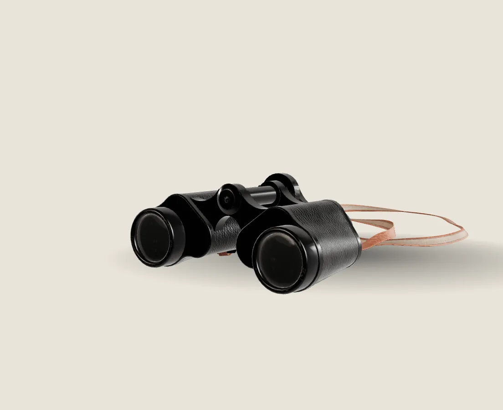

# Scroll-scrubbed 3D stage

Real CC0 scan + HDRI; camera and model move through chapter keyframes with scroll; lazy, poster fallback.

**Live demo:** [zyqor-concepts.sites.tab.bot/components/scroll-3d-stage/](https://zyqor-concepts.sites.tab.bot/components/scroll-3d-stage/) (desktop and phone)

## Files

- `index.html` (demo page)
- `poster.webp`
- `scroll-3d-stage.css`
- `scroll-3d-stage.js`

To use it, copy `scroll-3d-stage.js` and `scroll-3d-stage.css`. Everything else is the demo. No framework and no build step. The CSS below the line `/* demo page only */` styles the demo and can be deleted.

## Usage

```html
<script type="importmap">{ "imports": {
  "three": "/vendor/three/three.module.min.js",
  "three/addons/": "/vendor/three/addons/" } }</script>
<link rel="stylesheet" href="scroll-3d-stage.css">

<div class="s3">
  <div class="s3-pin">
    
    <div class="s3-canvas" aria-hidden="true"></div>
    <div class="s3-copy">
      <article class="s3-ch">...</article>   <!-- one per keyframe -->
    </div>
    <div class="s3-bar"><i></i></div>
  </div>
</div>

<script type="module">
  import { scrollStage } from './scroll-3d-stage.js';
  scrollStage({
    section: document.querySelector('.s3'),
    model: '/models/binoculars.glb', hdr: '/hdri/studio_1k.hdr',
    meshopt: '/vendor/three/addons/libs/meshopt_decoder.module.js',
    keys: [ { cam:[0,.25,3.6], look:[-.38,0,0], rot:[.12,-.55,0] },
            { cam:[0,.1,2.5],  look:[.36,0,0],  rot:[.05,.95,0] } ]
  });
</script>
```

## Options

| Option | Default | What it does |
|---|---|---|
| `section` | required | The tall section. Its height (--s3-len, default 420vh) sets how much scroll the story takes. |
| `model / hdr` | required / optional | GLB file and an equirectangular .hdr for image-based light. |
| `meshopt` | optional | Path to the meshopt decoder when the GLB is meshopt-compressed. |
| `keys` | required | One keyframe per chapter: cam (camera position), look (target), rot (model rotation, radians), exposure. |
| `size` | 1.6 | Model is centred and scaled to this size, so keyframes work for any model. |
| `fov / envIntensity / keyLight` | 30 / 1 / 1.4 | Lens and light. |

## Behaviour (desktop, phone, keyboard, reduced motion)

- Scroll only sets a target; the camera eases toward it each frame, so trackpad flicks and phone flings never jump.
- WebGL starts 300 px before the section reaches the screen; the loop pauses off screen and in hidden tabs.
- No WebGL, or a lost GPU context: the poster image stays and the chapters still read in order.
- Narrow screens centre the model above the copy and pull the camera back; same files, same quality.
- prefers-reduced-motion: no glide and no idle sway; each chapter is a still of its keyframe.
- Pixel ratio capped at 2 and lowered to 1.25 only if frames stay slow.

## Credits

- Model: ["Binoculars" by Derek Wight, Poly Haven](https://polyhaven.com/a/binoculars), CC0 1.0 (optimised: WebP textures, meshopt; all 19,248 triangles kept). HDRI: Poly Haven studio, CC0 1.0 (credit file next to it).
- Scroll-driven 3D product stories are the signature of [Opal Tadpole](https://www.opalcamera.com/opal-tadpole) (Awwwards SOTY 2024) and [landonorris.com](https://landonorris.com/) (SOTY 2025). Library: [three.js](https://threejs.org/) (MIT). Written from scratch.

## Licence

MIT, Zyqor Studio (Sujon Hoque). Third-party models, HDRIs and fonts keep their own licences (see the `.credit.json` file next to each, and the root `CREDITS.md`).
