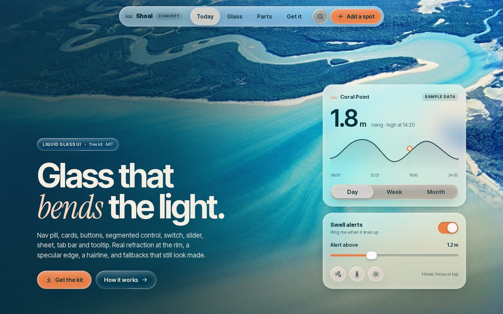
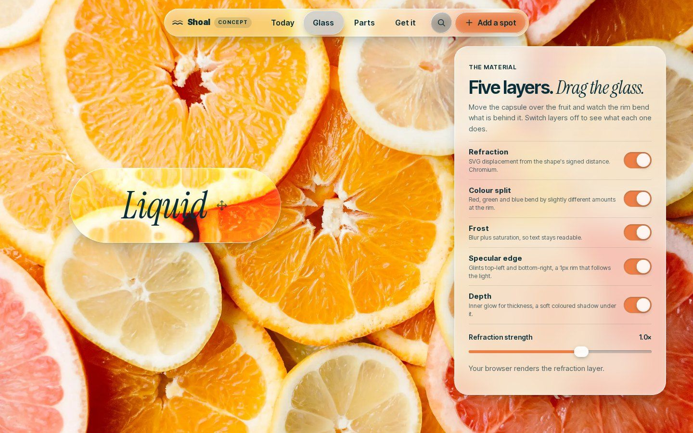
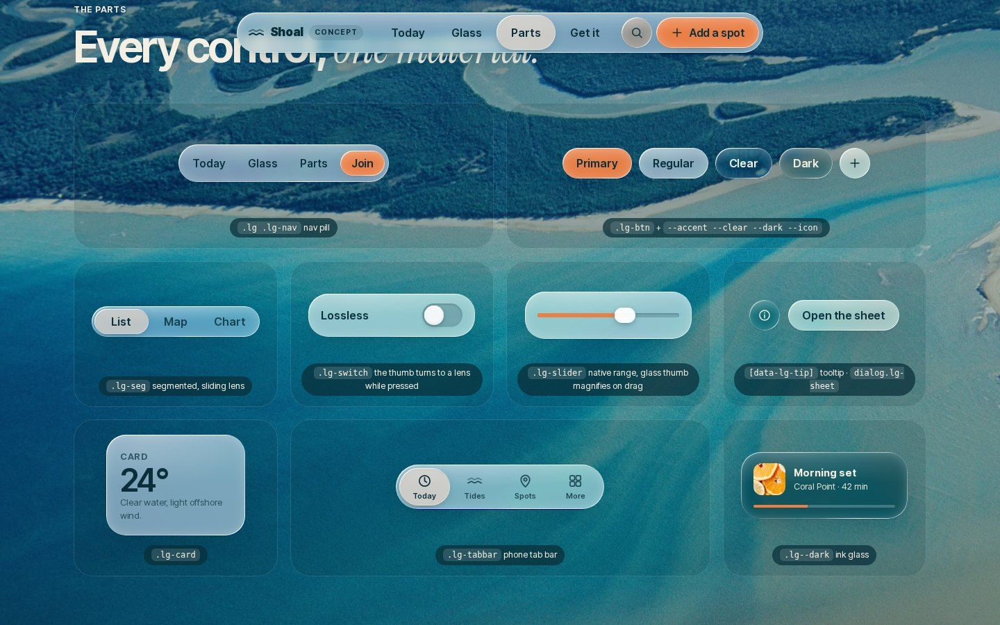
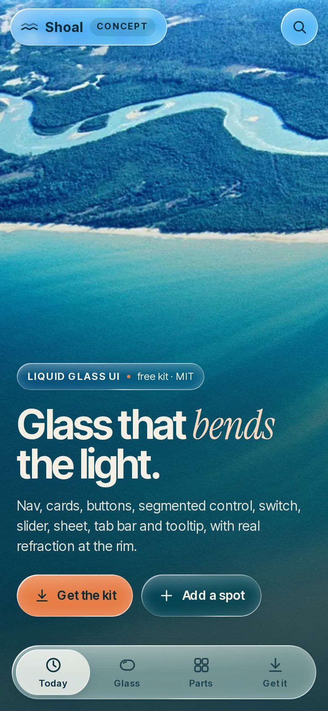
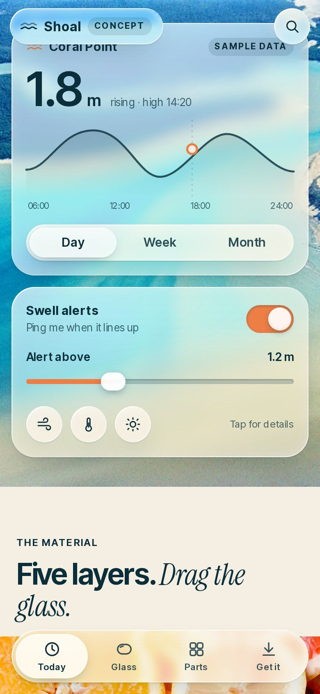
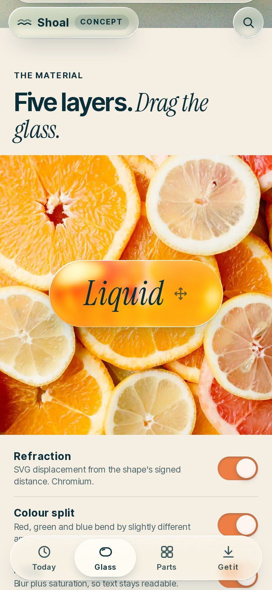
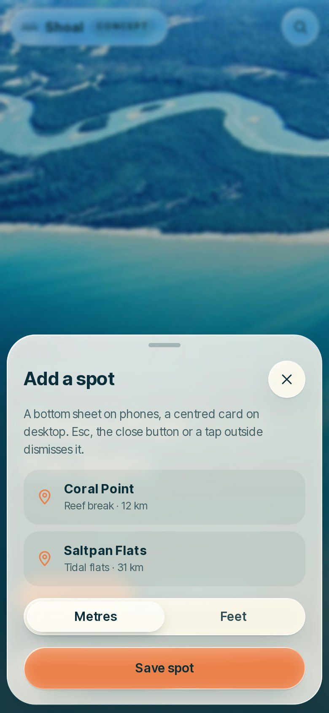
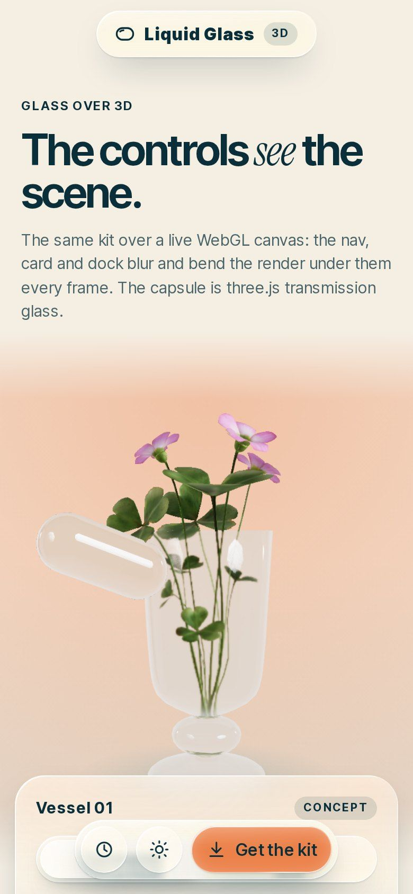
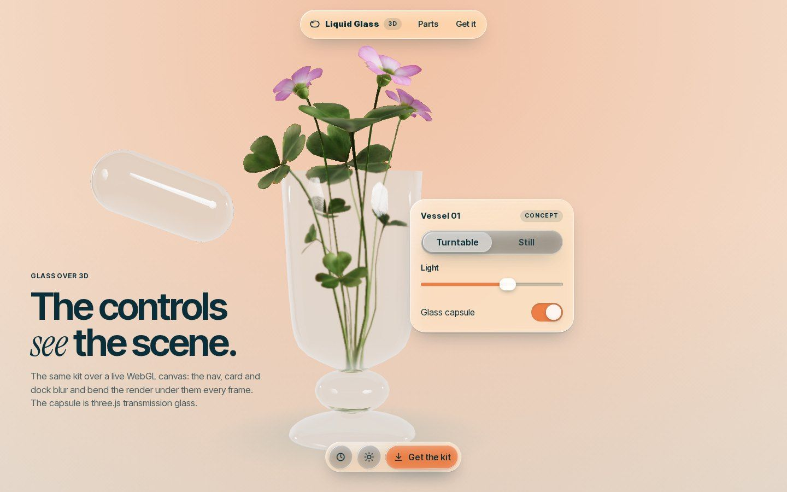

# Liquid Glass UI

**A free liquid-glass UI kit for the web, by Zyqor Studio.** Nav pill, cards, buttons, segmented control, switch, slider, sheet, phone tab bar and tooltip — with real refraction at the rim, a colour split, a specular edge, a hairline, depth, adaptive tint for floating bars, and fallbacks that still look finished. Plain CSS and one small script. No build step, no dependencies. MIT.



| Drag the glass over real fruit and switch each layer off | Every control, one material |
|---|---|
|  |  |

| Phone build | Widgets | Material | Bottom sheet | Over a live 3D scene |
|---|---|---|---|---|
|  |  |  |  |  |



All screenshots are our own, taken from the pages in `example/` (desktop 1440×900, phone 390×844).
"Shoal" and "Vessel 01" are fictional concepts made to show the kit; the spots and tide numbers are sample data.

## Install (3 lines)

```html
<link rel="stylesheet" href="kit/liquid-glass.css">
<script src="kit/liquid-glass.js" defer></script>
<nav class="lg lg-nav">…</nav>
```

Download just this folder: `npx degit zyqorbusiness-lab/best-website-designer/skills/liquid-glass-ui my-glass`
(or GitHub → Download ZIP and copy `skills/liquid-glass-ui/kit/`).

Run the examples locally: `npx serve .` inside this folder, then open `/example/` (desktop) or `/example/m.html` (phone; phones are sent there automatically), and `/example/scene.html` for the 3D scene.

## What is in it

| Part | Markup |
|---|---|
| Glass surface | `class="lg"` (+ `lg--clear`, `lg--dark`, `lg--accent`, `lg--dim`) |
| Nav pill | `<nav class="lg lg-nav">` |
| Buttons | `<button class="lg lg-btn">`, `lg-btn--icon` |
| Card | `<article class="lg lg-card">` |
| Segmented control | `<div class="lg lg-seg">` with `aria-pressed` buttons; a glass lens slides under the active one |
| Switch | `<button class="lg-switch" aria-checked="true">`; the thumb turns into a clear lens while pressed |
| Slider | `<div class="lg-slider"><input type="range"></div>`; the thumb magnifies the track while dragged |
| Sheet | `<dialog class="lg lg-sheet">` + `data-lg-open="id"`; `lg-sheet--bottom` on phones |
| Tab bar | `<nav class="lg lg-tabbar" role="tablist">` |
| Tooltip | `data-lg-tip="…"` on any button; hover, keyboard focus and tap |

The full method (the five layers with their values, contrast rules, performance budget, fallbacks, pitfalls) is in **[SKILL.md](SKILL.md)**. What "done" means is in **[checklist.md](checklist.md)**. The smallest page that uses every part is **[starter/index.html](starter/index.html)**.

## How the refraction works

`liquid-glass.js` measures each glass element, draws a displacement map from its rounded-rectangle signed distance (strong inward pull at the rim, falling off like the slope of a convex bevel, a slight magnification in the middle), and builds an SVG filter: blur → three `feDisplacementMap` passes (red, green, blue at 100/93/86%) → recombined. The element then uses `backdrop-filter: url(#that-filter) saturate() brightness()`. Filters are cached per size and rebuilt when the element resizes.

## Browser support

| Browser | Result |
|---|---|
| Chrome, Edge, Opera, Arc (desktop) | full material, refraction, colour split |
| Chrome on Android | full material, refraction on small controls |
| Safari (Mac, iPhone, iPad), every iOS browser, Firefox | frosted material with rim, glints, hairline and depth (WebKit and Gecko do not render SVG filters inside `backdrop-filter`) |
| Reduced transparency / reduced motion / high contrast / forced colours | solid, still, outlined or system-coloured versions, built in |

## Tested

On this kit's own pages, in headless Chromium at 1440×900, 390×844 and 360×740, plus an iPhone user agent (frosted fallback) and reduced motion: **0 console errors, 0 failed requests, 0 horizontal overflow** on all 10 runs; sheet open/close, tooltip (kept inside the viewport), switch, slider, segmented lens and the draggable specimen all checked by script. Text contrast was measured on 52 labels by sampling the real pixels behind each one: every label is at least **4.9:1** (worst 10th/90th percentile of its backdrop), median 5.2:1 or better. A real iPhone and a real Android phone have not been tested yet.

## Weights

| | Size |
|---|---|
| `kit/liquid-glass.css` | 15 KB (4.4 KB gzip) |
| `kit/liquid-glass.js` | 17 KB (6.0 KB gzip) |
| Example, desktop (HTML + CSS + JS + 3 fonts + 2 photos) | ≈ 0.95 MB, of which the second photo loads lazily |
| Example, phone (same photos, 1280 px) | ≈ 0.42 MB |
| 3D scene (three.js r170 + loaders + 228 KB model + 413 KB HDRI), same files on phone | ≈ 1.6 MB |

## Credits

- Photo: “Aerial View, Mackay” by Jack Bain, QUT Digital Collections, via [Wikimedia Commons](https://commons.wikimedia.org/wiki/File:Aerial_View,_Mackay_QUT-7351.jpg), CC0 1.0.
- Photo: “Citrus slices” by Joanna Malinowska, via [Wikimedia Commons](https://commons.wikimedia.org/wiki/File:Citrus_slices-1002778.jpeg), CC0 1.0.
- Model: “Glass Vase Flowers” — vase by Eric Chadwick, flowers by Rico Cilliers, 2023, CC0 1.0, [Khronos glTF Sample Assets](https://github.com/KhronosGroup/glTF-Sample-Assets/tree/main/Models/GlassVaseFlowers) (meshopt + WebP recompression). Only the transmission vase is shown; the second vase and its half of the bouquet are removed in code.
- Lighting: “Studio Small 09” HDRI by Sergej Majboroda, [Poly Haven](https://polyhaven.com/a/studio_small_09), CC0 1.0.
- Fonts: Inter Tight (Rasmus Andersson et al.) and Instrument Serif (Instrument), SIL Open Font License 1.1.
- three.js r170 (MIT), in `example/vendor/three/`.
- Signed-distance function for a rounded box after Inigo Quilez.
- Icons drawn for this kit (inline SVG).
- Distilled from the liquid-glass work on Zyqor Studio's portfolio v3.

## Licence

MIT for the code and the text (see [LICENSE](LICENSE)). The photos, model and HDRI are CC0; the fonts are SIL OFL 1.1; three.js is MIT.
