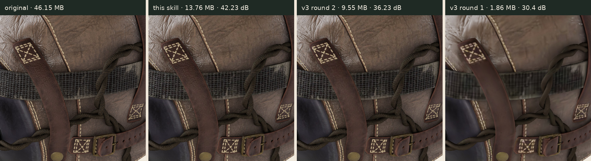
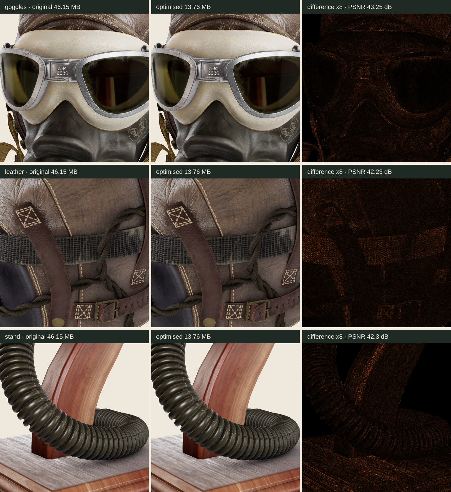
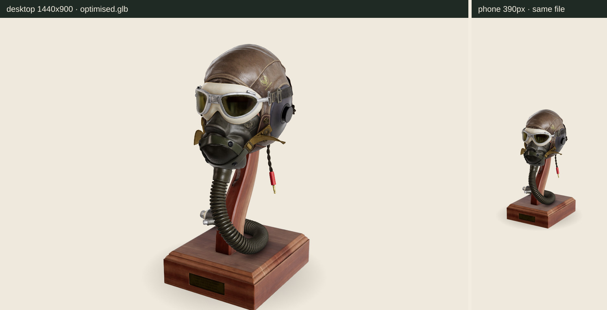
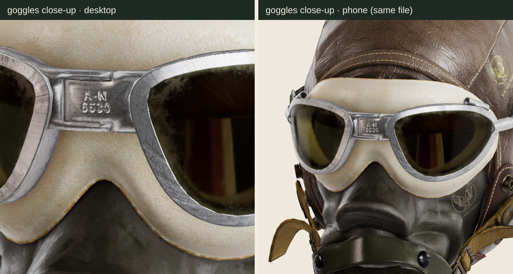
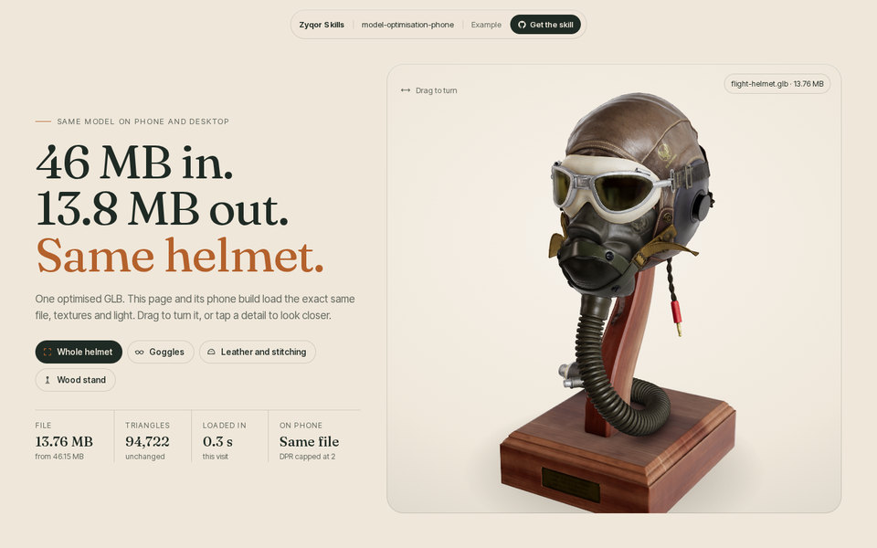
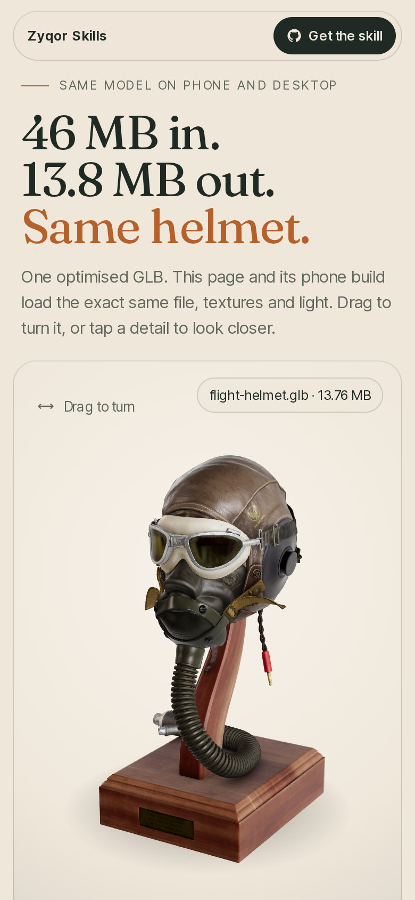
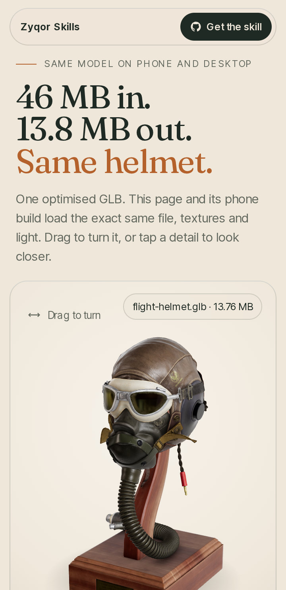

# model-optimisation-phone

**One model in. One optimised GLB out. Desktop and phone load the same file, and it looks the same.**
Part of the Zyqor Studio skills. MIT.


*Leather close-up rendered from the real model. Left to right: original 46.15 MB, this skill 13.76 MB (IDENTICAL), v3 round-2 recipe 9.55 MB, v3 round-1 recipe 1.86 MB (VISIBLE CHANGE).*

## Use it in 3 lines
```bash
npm install                                                  # inside this folder
node starter/optimise.mjs model.gltf model.glb --budget 14MB  # optimise + report
node starter/verify.mjs model.gltf model.glb --out verify/    # prove it looks the same (desktop + 390 px)
```
Then load `model.glb` with `starter/loader.js` on both builds. The full method, the guards and the reasons are in [SKILL.md](SKILL.md).

## The example: Flight Helmet (Khronos, CC0)
Source: 46.15 MB glTF, 94,722 triangles, 6 meshes, 15 PNG maps at 2048 px (leather, wood and rubber, metal, glass, lenses).

```
IN   FlightHelmet.gltf   46.15 MB  94,722 tris  15 textures  6 draw calls
OUT  flight-helmet.glb   13.76 MB  (29.8% of input)  94,722 tris  6 draw calls
     triangles unchanged: yes      validator: 0 errors, 0 warnings      budget 14.00 MB: PASS
```
Verification (`example/verify.json`): **IDENTICAL**, worst PSNR **42.23 dB**, worst changed pixels **0.319%** over 8 renders.

| Recipe | File | Textures | Worst PSNR | Pixels changed | Verdict |
|---|---|---|---|---|---|
| Original glTF (Khronos) | 46.15 MB | 15 PNG maps, 2048 px | reference | | |
| **This skill (shipped in example/)** | **13.76 MB** | 2048 px WebP q92, normals WebP near-lossless | **42.23 dB** | **0.319%** | **IDENTICAL** |
| Same, normals near-lossless 60 | 14.82 MB | | 42.88 dB | 0.197% | IDENTICAL |
| Same, normals near-lossless 20 | 13.18 MB | | 40.97 dB | 0.595% | IDENTICAL |
| Same + `--max-for "MetalParts\|GlassPlastic=1024"` | 10.18 MB | small parts at 1024 px | 39.54 dB | 0.778% | IDENTICAL (closer to the line) |
| KTX2, UASTC everywhere (`--textures ktx2`) | 35.74 MB | GPU memory 68 MB instead of 272 MB | 42.55 dB* | 0.373%* | IDENTICAL |
| KTX2, UASTC with RDO 3 (`--ktx-rdo 3`) | 32.12 MB | | 39.70 dB | 0.884% | IDENTICAL |
| KTX2 with ETC1S colour (`--colour-ktx etc1s`) | 28.76 MB | | 38.55 dB* | 1.467%* | VISIBLE CHANGE |
| v3 round-2 recipe (WebP q92 on every map, incl. normals) | 9.55 MB | | 36.23 dB | 2.531% | VISIBLE CHANGE |
| v3 round-1 recipe (1024 px, q75, 8-bit normals) | 1.86 MB | | 30.4 dB | 9.506% | VISIBLE CHANGE |

Worst of 8 renders: whole helmet + goggles + leather + stand, each on desktop (1440x900, DPR 1) and phone (390x844, DPR 3 capped to 2). Rows marked * were measured with the automatic close-ups instead of the named views. Pass mark: PSNR >= 38 dB and <= 1% of pixels moved by more than 12/255. All rows keep all 94,722 triangles.

### Close-ups: original | optimised | difference x8


### Same file on desktop and phone



### The example page
`example/index.html` (desktop) and `example/m.html` (phone, chosen by screen width) load the same `models/flight-helmet.glb`, the same HDRI and the same `loader.js`. Drag to turn, tap a detail to fly to it, then compare the original against three recipes with a slider and live numbers.

| Desktop 1440 | Phone 390 | Phone 360 |
|---|---|---|
|  |  |  |

Serve it with any static server, e.g. `npx serve example`. (`models/flight-helmet.glb` is 13.76 MB; in the Zyqor repo it is stored as `.part` files and rebuilt by `tools/join-parts.mjs`.)

## What is in here
| Path | What |
|---|---|
| `SKILL.md` | the method, step by step, for people and AI agents |
| `starter/optimise.mjs` | optimiser with guards, before/after report, budget, validator |
| `starter/verify.mjs` | desktop + 390 px renders, close-ups, PSNR, crops, verdict |
| `starter/loader.js` | three.js viewer for both builds (meshopt/draco/KTX2, HDRI, lazy, pause, DPR 2, poster) |
| `starter/recipe.sh` | the same safe recipe as plain glTF Transform CLI commands |
| `example/` | Flight Helmet through the pipeline, desktop + phone pages, report, verify output, screens |
| `checklist.md` | what "done" means |

## Credits
- Flight Helmet by Gary Hsu, [Khronos glTF Sample Assets](https://github.com/KhronosGroup/glTF-Sample-Assets/tree/main/Models/FlightHelmet), CC0 1.0.
- "Studio Small 09" HDRI by Sergej Majboroda, [Poly Haven](https://polyhaven.com/a/studio_small_09), CC0 1.0.
- Fonts in the example: Fraunces (Undercase Type) and Inter Tight (Rasmus Andersson et al.), SIL Open Font License 1.1.
- Built on [glTF Transform](https://gltf-transform.dev/) (MIT), [meshoptimizer](https://github.com/zeux/meshoptimizer) (MIT), [sharp](https://sharp.pixelplumbing.com/) (Apache-2.0), [three.js](https://threejs.org/) (MIT), [KTX-Software](https://github.com/KhronosGroup/KTX-Software) (Apache-2.0), Playwright (Apache-2.0).
- Every image in this README is a render of the real model or a screenshot of the example page, made by this skill. No AI images.

## Licence
MIT for the code and text (see `LICENSE`). The example model, HDRI and fonts keep their own licences above.
