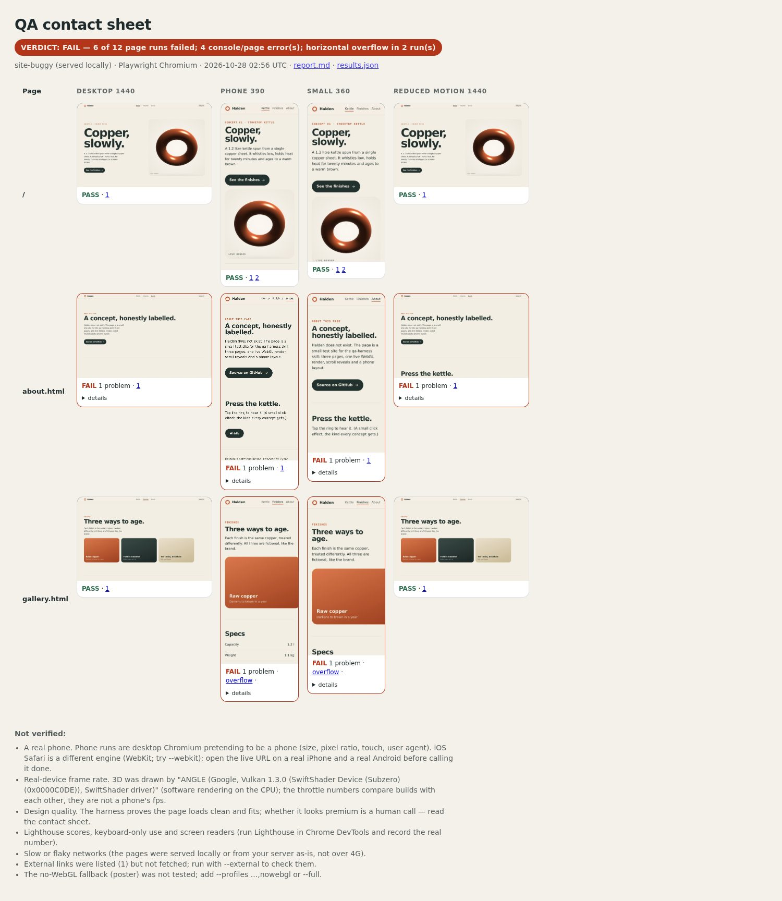
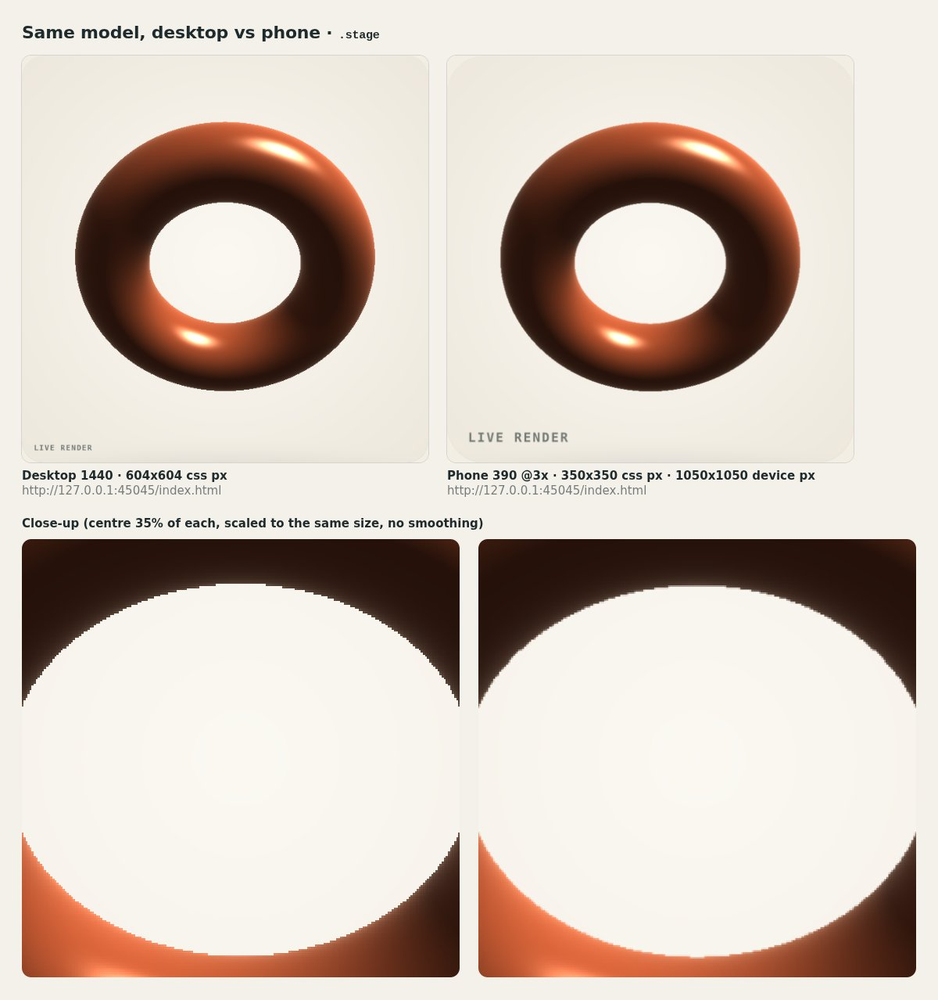

# qa-harness

**One command that checks every page of your site the way a picky reviewer would** — at desktop 1440x900, phone 390x844 and small phone 360x740, plus a reduced-motion pass — and ends with a plain `VERDICT: PASS` or `VERDICT: FAIL` and the list of things it could not verify.



Built by Zyqor Studio while shipping a portfolio of 18 WebGL concept pages (desktop and separate phone builds). Every check in here exists because that bug happened at least once.

## Install and run (3 lines)

```bash
npx degit zyqorbusiness-lab/best-website-designer/skills/qa-harness qa-harness   # or download the folder
cd qa-harness && npm install && npx playwright install chromium                    # ~170 MB browser, once
node qa.mjs ../your-site                                                            # a folder, or https://your-preview.url
```

Already have Google Chrome? Skip `npx playwright install` — the harness finds Chrome on its own, or pass `--chrome /path/to/chrome`. Node 18 or newer.

## What you get

```
qa-report/
  report.md      pass/fail table, every problem with evidence, links, throttle numbers, "Not verified", VERDICT
  report.html    contact sheet: every page x every size, red border = failed run, click for full screenshots
  results.json   everything, machine-readable (for CI or your own dashboards)
  shots/         top + 4 scroll screenshots per run, overflow evidence, idle-motion diffs
```

Exit code `0` on PASS and `1` on FAIL, so it drops straight into CI (`starter/qa.yml` is a ready GitHub Actions workflow).

## What it checks

For every page, at every size, it loads the page, waits for it to settle, scrolls all the way down like a person (mouse wheel on desktop, so smooth-scroll libraries react), and records:

- **Console errors and uncaught exceptions** with file and line. Warnings are listed separately.
- **Failed requests** and every 4xx/5xx response (missing model, font, texture, video).
- **Horizontal overflow at every scroll position** — and the **overflow finder** names the element that sticks out past the screen and past its own parent, by how many pixels, plus the container where the fix belongs ("a flex row that does not wrap: let items shrink, wrap them, or make the row scroll"). The evidence screenshot is taken wider than the phone with the screen edge drawn as a dashed line.
- **WebGL**: whether the browser had it, what drew it, and whether the page asked for it and got nothing.
- **Stuck reveals**: text still invisible after a full scroll, the classic scroll-reveal bug.
- **Reduced motion**: endless animations still running, and a pixel diff that catches a 3D scene that keeps spinning on its own (with the area and a red diff image).
- **Images**: failed loads, missing `alt`.
- **Layout shift** while loading (CLS).
- **Links**: every internal link and asset (from the HTML *and* from the rendered page, so JS menus count), in-page `#anchors`, external links opening in a new tab, and — with `--external` — whether external links still answer (sites that wall bots are reported as "open by hand", not broken).

Extra runs:

- **CPU-throttle smoke** (phone, CPU 4x slower): load time, frames while scrolling, long tasks. Catches pages that freeze or throw on slow phones.
- **No-WebGL** (`--profiles ...,nowebgl` or `--full`): the page with WebGL switched off must not throw and must show its poster.
- **Same model on phone** (`tools/compare.mjs`): the desktop build and the phone build side by side, cropped to the canvas, with a pixel close-up row — proof that the phone got the same model and textures, only compressed.
- **Overflow finder alone** (`tools/overflow.mjs ./site gallery.html 360`, or a URL): for the moment you are fixing one page.
- **Contact sheet as one image** (`tools/shoot-report.mjs qa-report/report.html sheet.jpg`): for a hand-off or a README.

Separate phone builds are understood out of the box: a folder with `index.html` and `m.html` is one page; desktop sizes load `index.html`, phone sizes load `m.html`.

## Examples

```bash
node qa.mjs ./site                                      # every .html in the folder, default 4 sizes
node qa.mjs ./site --pages /,work/,about.html           # just these
node qa.mjs ./site --full --external                    # all 6 profiles, throttle on every page, fetch external links
node qa.mjs https://preview.example.com --max-pages 20  # a live site (same-origin crawl)
node qa.mjs ./site --preset zyqor                       # house rules: emoji, placeholder text, same-tab external links FAIL
node qa.mjs ./site --strict                             # any warning fails
node qa.mjs ./site --webkit                             # phone sizes in WebKit, Safari's engine (npx playwright install webkit)
node qa.mjs https://preview.example.com --remote browserbase   # a cloud browser (needs BROWSERBASE_API_KEY, BROWSERBASE_PROJECT_ID)
node tools/compare.mjs ./site --desktop lab/hush/index.html --phone lab/hush/m.html --selector canvas \
  --focus-desktop 0.33,0.72,0.2 --focus-phone 0.26,0.66,0.3 --out hush.jpg   # close-up on the same part of the model
```

Config file (`qa.config.json` in the site folder; see `starter/`): pages, profiles, waits, the few console messages you deliberately ignore.

## The example in this folder

`example/site-buggy/` is a three-page concept site with two deliberate bugs: a swatch row that is 1200px wide on a phone, and a script that looks for `.whistle-btn` when the button is `#whistle`. `example/report-buggy/` is the real report the harness wrote:

```
VERDICT: FAIL — 6 of 12 page runs failed; 4 console/page error(s); horizontal overflow in 2 run(s)
  FAIL  about.html   all 4 sizes   uncaught error: Cannot read properties of null (reading 'addEventListener') (about.html:31)
  FAIL  gallery.html 390 and 360   page is 1200px wide — div.strip > div.swatch.s3 sticks out 810px; fix at div.strip
  PASS  home         all 4 sizes
```

The overflow evidence (`example/report-buggy/shots/gallery__phone__overflow.jpg`) is taken wider than the phone, with the culprits outlined and the screen edge dashed:


`example/site-fixed/` fixes both in three lines. `example/report-fixed/`:

```
VERDICT: PASS — 3 page(s), 18 runs, 0 console errors, 0 overflow, 0 broken links
(--full --preset zyqor: desktop, phone, small, reduced motion 1440 and 390, no-WebGL, plus the CPU-throttle smoke run on every page)
```

## Tested on

- **This example**, on Linux with Playwright's Chromium (headless shell 153) and software WebGL: the outputs in `example/` are that real run.
- **Three WebGL pages of the Zyqor portfolio v3** (hush, volta, verdant: real CC0 models, GSAP scroll, separate `m.html` phone builds), 15 runs. Default sizes: 12/12 PASS, 0 console errors, 0 failed requests, 0 overflow at 1440/390/360. It also found three things worth fixing that two earlier manual QA passes missed: all three pages **throw when WebGL is unavailable** (the shared renderer setup has no fallback), one page's background canvas **keeps animating under reduced motion** (3.7% of the screen, red diff image), and one `#inside` link has no matching id (handled by script, so a warning, not a failure).
- **A live preview from a cloud browser** (`--remote browserbase`): same verdict as local, and the phone run followed the site's own redirect to its phone build.
- **WebKit 26.6** (`--webkit`) on the example: the fixed site passes at 390/360/reduced motion, the buggy gallery fails with the same 810px overflow.



## Honest limits

- Phone runs are Chromium with a phone's size, pixel ratio, touch and user agent; `--webkit` runs them in WebKit (Safari's engine) instead, which catches Safari-only layout bugs but is still not an iPhone. **Open the live URL on a real iPhone and a real Android** before you call it done. The report says so every time.
- 3D is drawn with software WebGL (SwiftShader) by default so results match on every machine; the frame rates are for comparing builds, not a phone's real fps. `--gpu` uses your GPU.
- It proves a page loads clean and fits. It does not judge whether it looks premium. Open the contact sheet.
- No Lighthouse, keyboard or screen-reader audit; `checklist.md` lists those human checks.
- A remote browser cannot reach a folder on your machine; deploy a preview and test its URL.
- Software WebGL is CPU-heavy. On a shared machine run one harness at a time (e.g. `flock /tmp/chrome.lock node qa.mjs ./site`).
- The `--preset zyqor` house rules (no emoji, no placeholder text, external links in a new tab) are one studio's taste; leave the preset off and they are warnings.

## Files

| Path | What it is |
|---|---|
| `qa.mjs` | the CLI |
| `lib/server.mjs` | tiny static server (MIME types, folder index, Range requests for video) |
| `lib/browser.mjs` | finds Playwright and a Chrome, or connects over CDP |
| `lib/probes.mjs` | in-page checks: overflow finder, WebGL, stuck reveals, content, frame timing |
| `lib/diff.mjs` | pixel diff computed in the browser (no image libraries) |
| `lib/report.mjs` | `report.md`, `report.html`, verdict, "Not verified" |
| `tools/compare.mjs` | desktop vs phone, same model, side by side |
| `tools/overflow.mjs` | the overflow finder alone |
| `tools/shoot-report.mjs` | the contact sheet as one JPEG |
| `adapters/browserbase.mjs` | optional cloud browser |
| `starter/` | `qa.config.json`, GitHub Actions workflow |
| `example/` | buggy site + its report, fixed site + its report |
| `SKILL.md` | the method, for people and AI coding agents |
| `checklist.md` | what "done" means |

## Licence

MIT (see `LICENSE`). Written by Zyqor Studio (Sujon Hoque). The example site uses no third-party assets: the ring is drawn by a hand-written shader, the icons are inline SVG, the fonts are the system's. Playwright is Apache-2.0, installed by you, not bundled.
