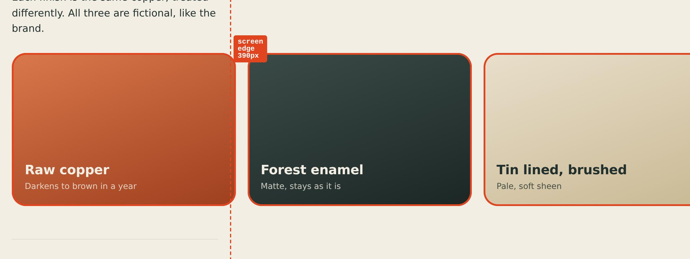
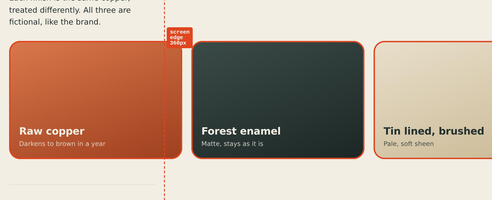

# QA report

**VERDICT: FAIL — 6 of 12 page runs failed; 4 console/page error(s); horizontal overflow in 2 run(s)**

- Target: site-buggy (served locally)
- Browser: Playwright Chromium (153.0.8010.12), WebGL2 yes (ANGLE (Google, Vulkan 1.3.0 (SwiftShader Device (Subzero) (0x0000C0DE)), SwiftShader driver))
- Ran: 2026-10-28 02:56:57 UTC → 02:57:47 UTC
- Profiles: Desktop 1440 (1440x900) · Phone 390 (390x844) · Small 360 (360x740) · Reduced motion 1440 (1440x900, reduced motion)
- Totals: 3 pages, 12 runs, 6 passed · console/page errors 4 · failed requests 0 · overflow runs 2 · warnings 0

## Pass/fail table

| Page | Desktop 1440 | Phone 390 | Small 360 | Reduced motion 1440 |
|---|---|---|---|---|
| `/` | PASS | PASS | PASS | PASS |
| `about.html` | FAIL (1) | FAIL (1) | FAIL (1) | FAIL (1) |
| `gallery.html` | PASS | FAIL (1) | FAIL (1) | PASS |

PASS = no console errors, no uncaught errors, no failed requests, no horizontal overflow, no broken images. (n) = number of problems, w = warnings.

## Problems, page by page

### `about.html`

**Desktop 1440** — FAIL

- FAIL: uncaught error: Cannot read properties of null (reading 'addEventListener') (about.html:31)

**Phone 390** — FAIL

- FAIL: uncaught error: Cannot read properties of null (reading 'addEventListener') (about.html:31)

**Small 360** — FAIL

- FAIL: uncaught error: Cannot read properties of null (reading 'addEventListener') (about.html:31)

**Reduced motion 1440** — FAIL

- FAIL: uncaught error: Cannot read properties of null (reading 'addEventListener') (about.html:31)

### `gallery.html`

**Phone 390** — FAIL

- FAIL: horizontal overflow: page is 1200px wide in a 390px viewport — div.strip > div.swatch.s3:nth-of-type(3) sticks out 810px; fix at section:nth-of-type(1) > div.strip

  Overflow finder (page 1200px in 390px, worst at scrollY 0):

  - `main > section:nth-of-type(1) > div.strip > div.swatch.s3:nth-of-type(3)` — 810px past the edge (left 820, right 1200, width 380; css width 380px) “Tin lined, brushed Pale, soft sheen”
  - `main > section:nth-of-type(1) > div.strip > div.swatch.s2:nth-of-type(2)` — 410px past the edge (left 420, right 800, width 380; css width 380px) “Forest enamel Matte, stays as it is”
  - `main > section:nth-of-type(1) > div.strip > div.swatch.s1:nth-of-type(1)` — 10px past the edge (left 20, right 400, width 380; css width 380px) “Raw copper Darkens to brown in a year”

  Fix at: `main > section:nth-of-type(1) > div.strip` (350px wide, display flex, flex-wrap nowrap, overflow-x visible) holds 3 of the culprits: a flex row that does not wrap: let items shrink (flex: 1 1 auto; min-width: 0), wrap them, or make the row scroll (overflow-x: auto).

  Evidence (culprits outlined in orange): 

**Small 360** — FAIL

- FAIL: horizontal overflow: page is 1200px wide in a 360px viewport — div.strip > div.swatch.s3:nth-of-type(3) sticks out 840px; fix at section:nth-of-type(1) > div.strip

  Overflow finder (page 1200px in 360px, worst at scrollY 0):

  - `main > section:nth-of-type(1) > div.strip > div.swatch.s3:nth-of-type(3)` — 840px past the edge (left 820, right 1200, width 380; css width 380px) “Tin lined, brushed Pale, soft sheen”
  - `main > section:nth-of-type(1) > div.strip > div.swatch.s2:nth-of-type(2)` — 440px past the edge (left 420, right 800, width 380; css width 380px) “Forest enamel Matte, stays as it is”
  - `main > section:nth-of-type(1) > div.strip > div.swatch.s1:nth-of-type(1)` — 40px past the edge (left 20, right 400, width 380; css width 380px) “Raw copper Darkens to brown in a year”

  Fix at: `main > section:nth-of-type(1) > div.strip` (320px wide, display flex, flex-wrap nowrap, overflow-x visible) holds 3 of the culprits: a flex row that does not wrap: let items shrink (flex: 1 1 auto; min-width: 0), wrap them, or make the row scroll (overflow-x: auto).

  Evidence (culprits outlined in orange): 

## Links

- Internal URLs checked: 6 · broken: 0
- In-page anchors checked: 0 · no element with that id: 0
- External links found: 1 (not fetched; use --external)
- External links without target="_blank": 1
  - /about.html → https://github.com/zyqorbusiness-lab/best-website-designer (“Source on GitHub”)

## CPU-throttle smoke run (phone 390, CPU 4x slower)

| Page | Load | Scroll fps | Median frame | p95 frame | Frames > 50 ms | Long tasks | Notes |
|---|---|---|---|---|---|---|---|
| `/` | 67 ms | 60 | 16.7 ms | 16.8 ms | 0 | 0 (worst 0 ms) | ok |

A smoke test, not a benchmark: it catches pages that break or freeze on a slow CPU. Compare these numbers between builds, not with a phone.

## Not verified (say so, do not assume)

- A real phone. Phone runs are desktop Chromium pretending to be a phone (size, pixel ratio, touch, user agent). iOS Safari is a different engine (WebKit; try --webkit): open the live URL on a real iPhone and a real Android before calling it done.
- Real-device frame rate. 3D was drawn by "ANGLE (Google, Vulkan 1.3.0 (SwiftShader Device (Subzero) (0x0000C0DE)), SwiftShader driver)" (software rendering on the CPU); the throttle numbers compare builds with each other, they are not a phone's fps.
- Design quality. The harness proves the page loads clean and fits; whether it looks premium is a human call — read the contact sheet.
- Lighthouse scores, keyboard-only use and screen readers (run Lighthouse in Chrome DevTools and record the real number).
- Slow or flaky networks (the pages were served locally or from your server as-is, not over 4G).
- External links were listed (1) but not fetched; run with --external to check them.
- The no-WebGL fallback (poster) was not tested; add --profiles ...,nowebgl or --full.

**VERDICT: FAIL — 6 of 12 page runs failed; 4 console/page error(s); horizontal overflow in 2 run(s)**
